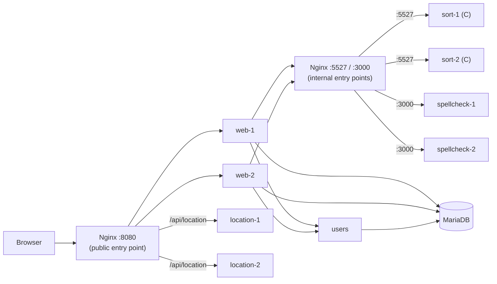

# Taste City

A restaurant recommendation app built as a set of microservices. Users can add restaurants, organize them into a personal collection, and sort and search them. Each feature is handled by its own service, written in Node.js, Python, or C, running in Docker behind an Nginx load balancer.

Originally a class project on microservices, Taste City has since been containerized with Docker and extended with an Nginx load balancer as a hands-on way to learn about scaling and failover.

## Architecture



Both Nginx boxes are the same container, listening on several ports: 8080 is published for the browser, while 5527 and 3000 are reachable only inside Docker.

| Service | Language | Port | Role |
|---|---|---|---|
| `nginx` | Nginx | 8080 (public) | Single entry point; load balances `web` and `location` |
| `web` | Node.js (Express, Handlebars) | 57891 | Pages and app logic; calls the other services |
| `location` | Python (Flask) | 2212 | US states and cities for the location dropdowns |
| `spellcheck` | Python (Flask) | 3000 | Spell checks restaurant names |
| `users` | Python (Flask) | 5000 | Verifies login credentials |
| `sort` | C | 5527 | Sorts restaurant lists by name, date, or number |
| `db` | MariaDB | 3306 | Users and restaurants |

## Load Balancing

`web`, `location`, `sort`, and `spellcheck` each run **two replicas**. Nginx distributes requests between them:

- **Round robin:** requests alternate between replicas.
- **Service discovery:** Nginx finds replicas through Docker's internal DNS, re-checking every 10 seconds, so scaling up or down needs no config change.
- **Passive health checks and failover:** if a replica fails twice, Nginx stops sending it traffic for 10 seconds, and retries the failed request on another replica, so users don't see the error.
- **Startup health checks:** Docker Compose starts Nginx only after every replica passes its health check.
- **Safe retries:** failed requests to the sort and spellcheck services are retried on another replica, even though they're `POST` requests, because neither has side effects. Requests that change data, like adding a restaurant, are never retried automatically.

Both services are **stateless**: each replica can handle any request, since data lives in MariaDB, not in memory. That's what makes load balancing them safe without sticky sessions.

### See it in action

With the app running, send several requests and check which replica answers. Nginx adds an `X-Upstream` header with the replica's address:

```bash
for i in 1 2 3 4 5 6; do
  curl -s -o /dev/null -D - http://localhost:8080/api/location/states | grep -i x-upstream
done
```

The sort and spellcheck services aren't reachable from outside Docker, so check them from inside the web container:

```bash
docker compose exec web node -e "fetch('http://nginx:3000/spellcheck', {method: 'POST', headers: {'Content-Type': 'application/json'}, body: JSON.stringify({text: 'resturant'})}).then(r => console.log(r.headers.get('x-upstream')))"
```

The two addresses alternate. To see failover, stop one replica and run the loop again. Every request still succeeds, served by the remaining replica:

```bash
docker stop taste-city-location-1
# run the loop again, then bring the replica back:
docker start taste-city-location-1
```

Within about 10 seconds, requests alternate between both replicas again. Each service's logs also show which replica handled each request:

```bash
docker compose logs location --tail 10
```

## Getting Started

### Prerequisites

- [Docker Desktop](https://www.docker.com/products/docker-desktop/) (or Docker Engine with the Compose plugin)

### Run

```bash
git clone https://github.com/marvinh0913/Taste-City.git
cd Taste-City
cp .env.example .env    # then set your own database passwords
docker compose up --build -d
```

Open [http://localhost:8080](http://localhost:8080). The first run takes a minute or two to build the images and initialize the database. The tables are created automatically from `database/schema.sql`.

### Useful commands

```bash
docker compose ps                 # status and health of every service
docker compose logs -f web        # follow one service's logs
docker compose down               # stop everything (database data is kept)
docker compose down -v            # stop and delete the database
```

## Project Structure

```
Taste-City/
├── services/
│   ├── web/          Express app: routes, Handlebars views, static files
│   ├── location/     Flask service with US states and cities data
│   ├── spellcheck/   Flask spell checking service
│   ├── users/        Flask login verification service
│   └── sort/         C sorting service (uses the vendored cJSON library)
├── nginx/            Reverse proxy and load balancer config
├── database/         MariaDB schema
├── docs/             Original design diagram and screenshots
├── docker-compose.yml
└── .env.example
```

Each service has its own `Dockerfile`. The C service compiles in a multi-stage build, so its final image contains only the compiled program.

## Sort Service API

The sort service accepts a JSON `POST` and returns the sorted list. Inside the Docker network, other services reach it at `http://sort:5527`.

**Sort a list of strings** (`ALPHA` or `CHRONO`) **or numbers** (`NUMBER`):

```json
{ "type": "ALPHA", "items": ["The Hobbit", "Dune", "Little Women"] }
```

```json
{ "status": "success", "data": ["Dune", "Little Women", "The Hobbit"] }
```

**Sort objects by a field:**

```json
{
  "items": [{ "name": "Peri", "rating": 4 }, { "name": "Movie Diner", "rating": 5 }],
  "sortBy": "name"
}
```

Invalid requests (malformed JSON, a missing or unknown `type`, or items of the wrong type) return `400 Bad Request` with an error message.

## Known Limitations

## Known Limitations

- **Security is out of scope.** This project focuses on service architecture, not security hardening. For example, passwords are stored in plain text, the app runs over plain HTTP rather than HTTPS, and pages don't require a login.
- **Testing is manual.** There's no automated test suite; the services were tested by running them and exercising each feature by hand, along with direct requests to each service's endpoints.
- **The design diagram is out of date.** `docs/uml.png` reflects the original class version of the project.

## Tech Stack

Node.js, Express, Handlebars, Python, Flask, gunicorn, C, cJSON, MariaDB, Nginx, Docker, Docker Compose
